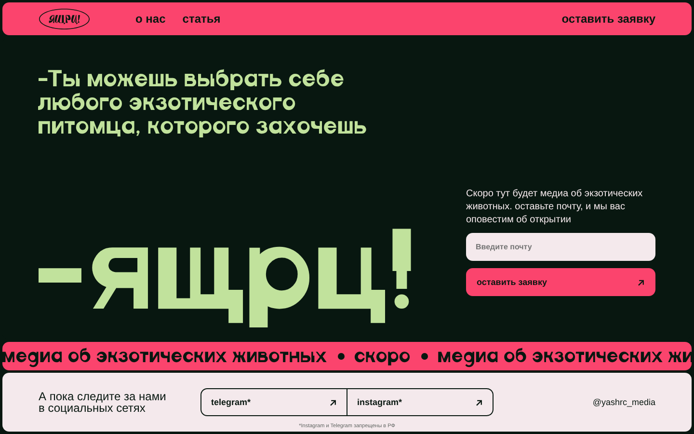
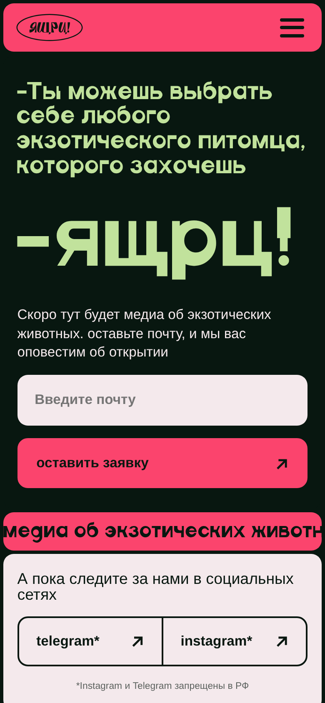
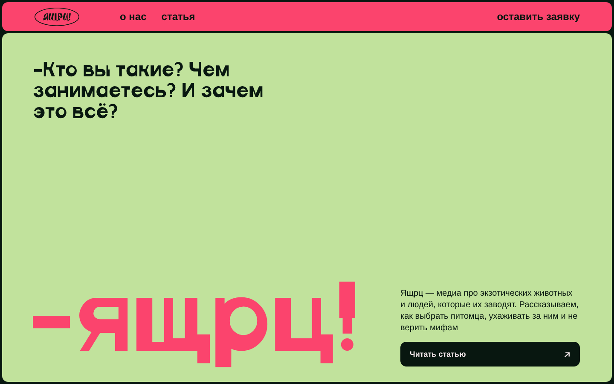
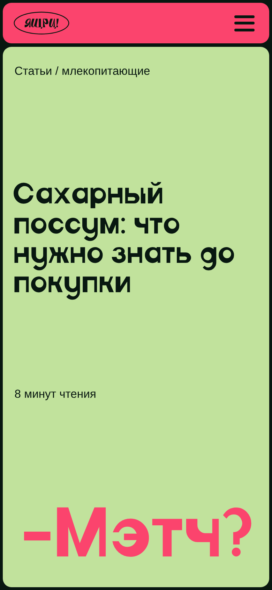

# ящрц!

Медиа об экзотических домашних животных для тех, кто только задумался завести питомца и боится ошибиться.

## Ссылки

- Сайт: [https://hseadc.github.io/zhivotnie/] — вставить после первого деплоя
- Макет в Figma: [ящрц — дизайн, адаптивы, прототип](https://www.figma.com/design/kZ9yAPrkjnMh4ennsUGzOJ/%D1%8F%D1%89%D1%80%D1%83?node-id=3-1080)

## Скриншоты

 

 

## Команда

| Участник | Что делал(а) |
| --- | --- |
| Юлия Бысова | Исследование и интервью, макеты страниц (заглушка, о нас, статья) и адаптивы, прототип, вёрстка сайта, сборка и деплой, презентация |
| Дарина Ломухина | Исследование и инсайты, соцсети и контент-план, прототип, мудборд, варфреймы, презентация |

## Стек

- HTML, CSS (вложенность через postcss-nested, postcss-preset-env, autoprefixer)
- Vite 6 — сборка многостраничного сайта в папку `docs`
- Formspree (`@formspree/ajax@1`) — форма сбора почт на заглушке
- GitHub Actions + GitHub Pages — деплой (`.github/workflows/deploy.yml`)

## Как запустить локально

```bash
git clone git@github.com:HSEADC/zhivotnie.git
cd zhivotnie
npm install
npm run dev
```

Сборка: `npm run build` (готовый сайт появится в `docs`). Деплой запускается пушем в ветку `gh-pages`.

## Структура проекта

```
src/                  — исходники сайта (корень для Vite)
src/index.html        — заглушка с формой
src/pages/            — о нас, статьи, справочник
src/pages/articles/   — статьи, готова «Сахарный поссум»
src/stylesheets/      — reset, fonts, layout, animation, adaptive
src/javascripts/      — чанки скриптов для страниц
src/images/           — фото, логотипы, фавикон
src/fonts/            — шрифты
src/ai/               — скриншоты для README
docs/                 — результат сборки
.github/workflows/    — деплой на GitHub Pages
```

Подробнее — в [structure.md](structure.md).

## Решения и сложности

- **Сетка как в макете.** Все размеры в `rem`, а `1rem` = `1px` макета: `html { font-size: min(1vw / 14.4, 1vh / 9) }`. Поэтому сайт масштабируется вместе с окном, а заглушка всегда помещается в один экран, даже если окно браузера не развёрнуто.
- **Первый экран на всю высоту.** Hero на всех страницах занимает высоту окна (`100svh` минус шапка), на планшете и телефоне — тоже.
- **Меню на планшете и телефоне** сделано без JavaScript: скрытый чекбокс и `label` (бургер и крестик), плашка-попап показывается через `:checked ~ .menu`.
- **Шрифт.** TT Modernoir Trial — пробная версия, встраивать её на сайт нельзя. Поэтому в `@font-face` сначала `local()` (шрифт с компьютера), а запасной — Desyatiy.
- **Стили подключены через `<link>`** в каждой странице, а не только через чанк Vite: так страницы со стилями открываются и в dev-режиме, и после сборки.
- **Сознательно не сделали:** страницы «Статьи», «Справочник» и ещё две статьи пока черновики — для них есть только варфреймы в Figma.

## Использование ИИ

### Инструменты

| Инструмент и модель | Кто | Для каких задач | Уровень (0–4) |
| --- | --- | --- | --- |
| Claude (Cowork, модель claude-opus-5-5) | Юлия | Вёрстка трёх страниц и адаптивов по макету, меню-попап, правки по замечаниям, фавикон, настройка структуры проекта и README | 4 |
| Claude (Cowork, модель claude-opus-5-5) | Юлия | Figma: адаптивы, варфреймы, прототип, слайды, посты, стикеры (через плагинный API) | 3 |

### Журнал запросов

#### #1 · 22.10.2026 · Юлия

- **Инструмент:** Claude (Cowork)
- **Задача:** сверстать заглушку, «О нас» и статью про поссума по макету, с адаптивами, сохранив структуру шаблона и форму Formspree.
- **Запрос:** «Сверстай сайт с адаптивами, которые у нас уже есть в дизайне, эти три страницы… структура сохраняется и стиль написания кода, но под наш сайт».
- **Что выдал ИИ:** HTML трёх страниц, `layout.css` и `adaptive.css`, шрифты и картинки из макета.
- **Что изменили и почему:** CSS не подключался при открытии страниц — добавили `<link>` на стили в каждую страницу. Попросила переделать шапку на планшете и телефоне (логотип + бургер с попапом), подвал столбиком, первый экран на всю высоту.
- **Итог и проверка:** скриншоты на 1440, 768 и 375/440 px, проверка в Chrome у себя (`npm run dev`).

#### #2 · 23.10.2026 · Юлия

- **Инструмент:** Claude (Cowork)
- **Задача:** заглушка на ноутбуке не помещается в экран, фото съехало, кнопки соцсетей не по центру, нужна сноска про запрет соцсетей, фавикон.
- **Запрос:** «Заглушка на ноуте с подвалом не встаёт во всю высоту, может привязать к rem все величины…»
- **Что выдал ИИ:** `rem` теперь зависит и от ширины, и от высоты окна; обрезана белая полоса на фото; сетка из трёх колонок в полосе соцсетей; фавикон из букв логотипа.
- **Что изменили и почему:** убрали обводку-овал из фавикона, «статьи» в меню заменили на «статья» со ссылкой на статью про поссума, поправили кнопку и стикер «статья 1» в блоке «Первая статья уже вышла», чтобы было как в макете.
- **Итог и проверка:** скриншоты окна 1440×780 и 1280×700, сверка с макетом в Figma.

### Рефлексия

[5–10 предложений от команды: где ИИ помог, где ошибался (например, CSS не подключался, кнопки и стикер стояли не как в макете, шрифт TT Modernoir нельзя встроить), что не взяли в проект, чему научились, что сделали бы иначе.]
